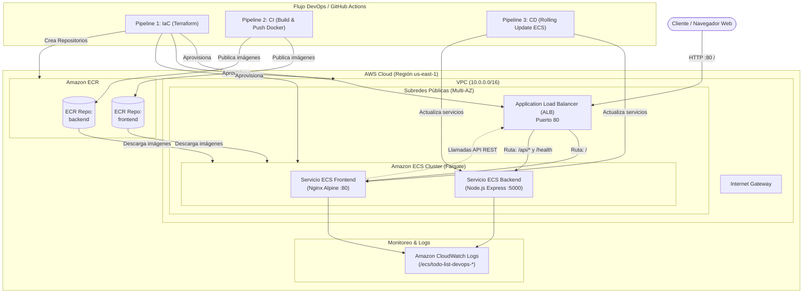

# Proyecto Final: TaskFlow Pro &bull; To-Do List con Tres Pipelines DevOps en AWS

**Universidad Tecnológica de Panamá (UTP)**  
**Facultad de Ingeniería de Sistemas Computacionales**  
**Asignatura:** Tópicos Especiales 1  

---

## 1. Descripción y Objetivo General

Diseñar, implementar y demostrar una aplicación web completa y moderna de gestión de notas, tareas y mini tareas (**TaskFlow Pro v2.3**) con un flujo integral de DevOps en Amazon Web Services (AWS):

1. **Infraestructura como Código (IaC):** Red (VPC multi-AZ), cómputo (ECS Fargate), balanceo (ALB) y registros (ECR) aprovisionados de forma reproducible mediante **Terraform**.
2. **Integración Continua (CI):** Construcción automatizada de imágenes Docker multicapa para Frontend (Nginx Alpine) y Backend (Node.js Express), etiquetadas con SHA y `latest`, y publicadas en **Amazon ECR**.
3. **Despliegue Continuo (CD):** Despliegue automatizado sin tiempo de inactividad (*Rolling Update*) sobre **Amazon ECS (AWS Fargate)** con verificación de salud (*Health Checks*) y enrutamiento por rutas mediante un **Application Load Balancer (ALB)**.
4. **Aplicación Web Funcional de Alto Nivel:** Autenticación de usuarios, espacios privados aislados, reordenamiento interactivo con Drag & Drop, modo oscuro/claro completo, gestión de carpetas personalizadas, mini tareas con progreso porcentual y un **Panel DevOps & Telemetría AWS** integrado.

---

## 2. Arquitectura de la Solución



---

## 3. Estructura del Repositorio

El proyecto cumple con la estructura modular exigida:

```text
├── .github/
│   └── workflows/              # Flujos de trabajo automáticos de GitHub Actions
│       ├── pipeline-1-infra.yml# Pipeline 1: Terraform IaC
│       ├── pipeline-2-ci.yml   # Pipeline 2: Docker Build & ECR Push
│       └── pipeline-3-cd.yml   # Pipeline 3: Despliegue continuo a ECS Fargate
├── aplicacion/                 # Código fuente de los microservicios
│   ├── backend/                # API REST en Node.js / Express
│   │   ├── Dockerfile          # Imagen liviana Node.js Alpine
│   │   ├── package.json        # Dependencias y scripts
│   │   └── server.js           # Lógica REST, endpoints, telemetría y autenticación
│   ├── frontend/               # Single Page Application moderna y responsiva
│   │   ├── app.js              # Lógica de cliente, Drag & Drop, estado y eventos
│   │   ├── Dockerfile          # Imagen optimizada Nginx Alpine
│   │   ├── favicon.svg         # Favicon vectorial de TaskFlow Pro
│   │   ├── index.html          # Maquetación semántica con TailwindCSS
│   │   ├── nginx.conf          # Servidor estático y proxy reverso
│   │   └── style.css           # Estilos personalizados, temas claro/oscuro y animaciones
│   └── docker-compose.yml      # Entorno de pruebas locales integradas
├── pipelines/                  # Definiciones y scripts de soporte de CI/CD
│   ├── pipeline-1-infra.yml    # Pipeline 1: Terraform IaC
│   ├── pipeline-2-ci.yml       # Pipeline 2: Docker Build & ECR Push
│   ├── pipeline-3-cd.yml       # Pipeline 3: Despliegue a ECS Fargate
│   ├── README.md               # Documentación específica de CI/CD
│   └── scripts/                # Scripts de ejecución manual/local (PowerShell)
│       ├── 1-deploy-infra.ps1
│       ├── 2-build-push.ps1
│       └── 3-deploy-ecs.ps1
├── terraform/                  # Código de Infraestructura como Código (IaC)
│   ├── alb.tf                  # Balanceador de carga y reglas de ruteo
│   ├── ecr.tf                  # Repositorios ECR y políticas de ciclo de vida
│   ├── ecs.tf                  # Clúster, tareas y servicios Fargate
│   ├── iam.tf                  # Roles de ejecución y tareas (personal o LabRole)
│   ├── outputs.tf              # Salidas de DNS, URLs y repositorios
│   ├── README.md               # Instrucciones de ejecución de Terraform
│   ├── security_groups.tf      # Reglas de firewall de red
│   ├── terraform.tfvars.example# Variables de ejemplo
│   ├── variables.tf            # Definición de variables de entrada
│   ├── versions.tf             # Versiones de proveedores requeridos
│   └── vpc.tf                  # VPC, subredes públicas e Internet Gateway
└── README.md                   # Documentación principal del proyecto
```

---

## 4. Funcionalidades de la Aplicación Web (TaskFlow Pro v2.3)

La aplicación ofrece una experiencia de usuario fluida, reactiva e intuitiva:

* **Autenticación y Espacios Privados de Trabajo:**
  - Registro de usuarios con captura de **Nombre Completo**, nombre de usuario y contraseña (validación de seguridad mínima de 8 caracteres).
  - Inicio de sesión con persistencia mediante tokens y almacenamiento local.
  - Aislamiento completo de datos: cada usuario tiene acceso único y privado a sus notas y carpetas.
  - Sistema de roles: **Administrador** (acceso al Panel DevOps & Telemetría AWS) y **Usuario Estándar**.
* **Reordenamiento Interactivo con Drag & Drop:**
  - Arrastre intuitivo de tarjetas de tareas para personalizar su orden (tanto con mouse como mediante toque táctil en dispositivos móviles con el icono `.drag-handle`).
  - Indicadores visuales en tiempo real (borde punteado y líneas guía superior/inferior).
  - Persistencia bidireccional inmediata en el backend (`PUT /api/tasks/reorder`) y en caché local.
* **Modo Oscuro / Modo Claro Completo:**
  - Selector temático accesible sobre la tarjeta del usuario en la barra lateral con alternancia de iconos (sol / luna).
  - Transición suave y cobertura total del tema oscuro en modales, dropdowns, calendarios y tablas.
* **Organización por Carpetas Dinámicas:**
  - Creación de carpetas personalizadas con paleta de colores distintivos e iconos temáticos (Trabajo, Estudio, Personal, etc.).
  - Filtro por carpetas y confirmación segura de eliminación conservando las tareas.
* **Vistas por Estado y Prioridad:**
  - Filtrado rápido: *Todas las tareas*, *Pendientes*, *En Curso*, *Completadas* y *Alta Prioridad* 🔥.
  - Regla de consistencia: al marcar como completada una tarea de alta prioridad, pasa a la sección de completadas.
* **Mini Tareas (Subtareas / Checklists):**
  - Desglose de actividades dentro de cada tarea con cálculo y barra de progreso porcentual.
* **Buscador Global en Tiempo Real:**
  - Búsqueda instantánea en títulos, notas, nombres de carpetas y subtareas con botón para limpiar filtros.
* **Botón "Actualizar":**
  - Sincronización rápida en vivo junto al botón *Nueva Tarea* con animación de recarga.
* **Componentes UI Modernos:**
  - Selector de fecha personalizado tipo calendario (popup claro/oscuro) que sustituye el selector nativo.
  - Diálogos y confirmaciones de sistema estilizados sin recurrir a los diálogos invasivos del navegador (`alert()` / `confirm()`).
* **Panel DevOps & Telemetría AWS:**
  - Visualización en tiempo real del estado de salud del backend, latencia HTTP (ms), Container ID / Hostname y tiempo de actividad (*uptime*).
  - Resumen visual de los 3 Pipelines CI/CD y ajuste en caliente del endpoint de la API.

---

## 5. Especificación de la API RESTful (Backend)

| Método | Endpoint | Descripción | Requiere Autenticación |
| :--- | :--- | :--- | :--- |
| `GET` | `/health` | Health Check para el ALB y monitoreo de ECS | No |
| `GET` | `/api/info` | Telemetría del contenedor (uptime, hostname, estado) | No |
| `POST` | `/api/auth/login` | Inicio de sesión de usuarios (Admin / Estándar) | No |
| `POST` | `/api/auth/register` | Registro de nueva cuenta con nombre completo | No |
| `GET` | `/api/auth/me` | Validación de sesión actual y obtención de perfil | Sí |
| `GET` | `/api/folders` | Obtener carpetas del usuario autenticado | Sí |
| `POST` | `/api/folders` | Crear nueva carpeta personalizada | Sí |
| `DELETE` | `/api/folders/:id` | Eliminar carpeta del usuario | Sí |
| `GET` | `/api/tasks` | Listar tareas con filtros (`folderId`, `status`, `priority`, `search`) | Sí |
| `GET` | `/api/tasks/:id` | Obtener detalle de una tarea específica | Sí |
| `POST` | `/api/tasks` | Crear nueva tarea / nota con mini tareas | Sí |
| `PUT` | `/api/tasks/:id` | Actualizar tarea (estado, prioridad, checklist, notas) | Sí |
| `PUT` | `/api/tasks/reorder` | **Guardar nuevo orden de tareas tras Drag & Drop** | Sí |
| `DELETE` | `/api/tasks/:id` | Eliminar tarea del usuario | Sí |

---

## 6. Credenciales de Prueba para Evaluación

Para facilitar la evaluación y demostración del proyecto, se incluyen los siguientes accesos:

* **Usuario Administrador:**
  - **Usuario:** `admin`
  - **Contraseña:** `12345678`
  - **Permisos:** Acceso completo a notas y al **Panel DevOps & Telemetría AWS**.
* **Nuevos Usuarios:**
  - Se puede registrar cualquier cuenta nueva desde la pestaña **"Crear Cuenta"** ingresando Nombre Completo, Usuario y una Contraseña de al menos 8 caracteres.

---

## 7. Requisitos Previos

* **Git:** Clonar este repositorio y tener cuenta en GitHub.
* **AWS CLI:** Instalado y configurado con credenciales de administrador o laboratorio.
* **Terraform:** Versión `>= 1.5.0`.
* **Docker & Docker Compose:** Para pruebas locales o empaquetado de contenedores.
* **Cuenta de AWS:** Cuenta personal o AWS Academy Learner Lab.

---

## 8. Configuración de Secretos en GitHub Actions

Para que los tres pipelines se ejecuten en GitHub Actions sin incluir credenciales en el código fuente:

1. Ve a tu repositorio en GitHub: **Settings > Secrets and variables > Actions**.
2. Haz clic en **New repository secret** y agrega:
   - `AWS_ACCESS_KEY_ID`: Tu clave de acceso de AWS.
   - `AWS_SECRET_ACCESS_KEY`: Tu clave secreta de AWS.
   - `AWS_SESSION_TOKEN`: *(Opcional, obligatorio si utilizas AWS Academy Learner Lab)*.

---

## 9. Pasos para Reproducir la Solución

### Opción A: Despliegue Automatizado con GitHub Actions (Recomendado para la Demo)

1. **Pipeline 1 - Infraestructura (Terraform):**
   - Ve a la pestaña **Actions** en GitHub.
   - Selecciona **Pipeline 1 - Infraestructura (Terraform)**.
   - Haz clic en **Run workflow** con la opción `apply`.
   - Al finalizar (~3 minutos), la pestaña del job imprimirá la URL pública del Application Load Balancer y los repositorios ECR creados.

2. **Pipeline 2 - Construcción y Publicación en ECR (CI):**
   - Se ejecuta automáticamente tras hacer push en la carpeta `aplicacion/` o manualmente desde la pestaña **Actions**.
   - Construye las imágenes Docker optimizadas del Frontend y Backend y las publica en Amazon ECR con tags de commit y `latest`.

3. **Pipeline 3 - Despliegue Continuo en ECS Fargate (CD):**
   - Se activa automáticamente al concluir exitosamente el Pipeline 2.
   - Ejecuta un *Rolling Update* en los servicios ECS Fargate, espera a que los contenedores alcancen estado estable (`services-stable`) y valida los endpoints de salud contra el Application Load Balancer.

---

### Opción B: Ejecución Local / Pruebas de Desarrollo

#### 1. Probar la aplicación en la máquina local (sin AWS):
```bash
cd aplicacion
docker compose up --build
```
* Abre tu navegador en `http://localhost:8080`.
* Verifica la comunicación con el Backend (`http://localhost:5000/api/info` y `http://localhost:5000/health`).

#### 2. Desplegar la infraestructura con Terraform manualmente:
```bash
cd terraform
cp terraform.tfvars.example terraform.tfvars
terraform init
terraform plan
terraform apply -auto-approve
```

---

## 10. Gestión de Secretos y Seguridad

* **Sin secretos en código:** No existen credenciales, contraseñas de AWS ni llaves hardcodeadas en el repositorio (cumpliendo estrictamente con las políticas de entrega).
* **Seguridad de Red en Capas (Defense in Depth):**
  - El Application Load Balancer es el único recurso expuesto a Internet en el puerto 80 dentro de las subredes públicas.
  - Los Security Groups de los servicios ECS Frontend y Backend restringen el tráfico exclusivamente al proveniente del ALB.
* **Aislamiento Multi-inquilino a nivel de datos:** Las consultas de base de datos en memoria están indexadas por el `userId` autenticado.

---

## 11. Guion para la Demostración en Vivo (Rúbrica: 100 Puntos)

| Minuto | Actividad de la Demostración | Criterio de la Rúbrica |
| :--- | :--- | :--- |
| **00:00 - 02:00** | Explicar la arquitectura en AWS (VPC Multi-AZ, Fargate, ALB, ECR) y la estructura modular del repositorio. | Organización y Arquitectura (15 pts) |
| **02:00 - 04:00** | Mostrar la ejecución del **Pipeline 1** y evidenciar en la consola de AWS los recursos creados (VPC, Clúster ECS, Repositorios ECR, Target Groups). | Terraform / IaC Funcional (25 pts) |
| **04:00 - 06:00** | Mostrar el **Pipeline 2**, verificar las imágenes construidas y publicadas en Amazon ECR con tags dinámicos. | Pipeline CI / Docker ECR (20 pts) |
| **06:00 - 08:00** | Demostrar el **Pipeline 3**, el *Rolling Update* en ECS Fargate sin caída de servicio y la comprobación de salud automática. | Pipeline CD / ECS Fargate (20 pts) |
| **08:00 - 10:00** | Abrir la app en el navegador mediante el ALB: iniciar sesión, crear tareas y carpetas, demostrar **Drag & Drop**, alternar **Modo Oscuro**, abrir el **Panel DevOps & Telemetría AWS** y verificar los logs en Amazon CloudWatch. | Aplicación Web Operativa (20 pts) |

---

## 12. Limpieza de Recursos (Destrucción)

Para evitar consumos de créditos una vez culminada la sustentación:
* **Desde GitHub Actions:** Ejecutar el **Pipeline 1** seleccionando la acción `destroy`.
* **Desde la terminal local:**
  ```bash
  cd terraform
  terraform destroy -auto-approve
  ```
