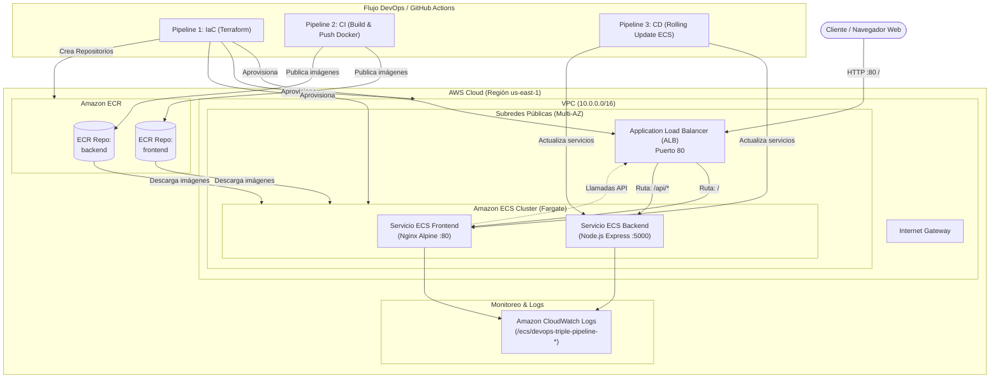

# Proyecto Final: Tres Pipelines DevOps en AWS

**Universidad Tecnológica de Panamá (UTP)**  
**Facultad de Ingeniería de Sistemas Computacionales**  
**Asignatura:** Tópicos Especiales 1  
**Profesor:** Asignación de Proyecto Final  

---

## 1. Descripción y Objetivo General

Diseñar, implementar y demostrar un flujo integral DevOps que abarca:
1. **Infraestructura como Código (IaC)** aprovisionada con **Terraform**.
2. **Integración Continua (CI)** con construcción y publicación de contenedores Docker en **Amazon ECR**.
3. **Despliegue Continuo (CD)** automatizado sobre **Amazon ECS (AWS Fargate)** con verificación de salud (*Health Checks*) y enrutamiento mediante un **Application Load Balancer (ALB)**.
4. **Aplicación Web Funcional**: Frontend en Nginx y Backend RESTful en Node.js comunicados a través de API.

---

## 2. Arquitectura de la Solución



---

## 3. Estructura del Repositorio

El proyecto cumple con la estructura solicitada:

```text
├── .github/
│   └── workflows/              # Flujos de trabajo automáticos de GitHub Actions
│       ├── pipeline-1-infra.yml
│       ├── pipeline-2-ci.yml
│       └── pipeline-3-cd.yml
├── aplicacion/                 # Código fuente de los microservicios
│   ├── backend/                # API REST en Node.js/Express
│   │   ├── Dockerfile
│   │   ├── package.json
│   │   └── server.js
│   ├── frontend/               # Panel web moderno y responsivo
│   │   ├── app.js
│   │   ├── Dockerfile
│   │   ├── index.html
│   │   ├── nginx.conf
│   │   └── style.css
│   └── docker-compose.yml      # Entorno de pruebas locales
├── pipelines/                  # Definiciones y scripts de los 3 pipelines
│   ├── pipeline-1-infra.yml    # Pipeline 1: Terraform IaC
│   ├── pipeline-2-ci.yml       # Pipeline 2: Docker Build & ECR Push
│   ├── pipeline-3-cd.yml       # Pipeline 3: Despliegue a ECS Fargate
│   ├── README.md               # Documentación específica de CI/CD
│   └── scripts/                # Scripts de ejecución manual/local (PowerShell)
│       ├── 1-deploy-infra.ps1
│       ├── 2-build-push.ps1
│       └── 3-deploy-ecs.ps1
├── terraform/                  # Código de Infraestructura como Código (IaC)
│   ├── alb.tf                  # Balanceador de carga y reglas de ruteo
│   ├── ecr.tf                  # Repositorios ECR y políticas de ciclo de vida
│   ├── ecs.tf                  # Clúster, tareas y servicios Fargate
│   ├── iam.tf                  # Roles de ejecución y tareas (personal o LabRole)
│   ├── outputs.tf              # Salidas de DNS, URLs y repositorios
│   ├── README.md               # Instrucciones de ejecución de Terraform
│   ├── security_groups.tf      # Reglas de firewall de red
│   ├── terraform.tfvars.example# Variables de ejemplo
│   ├── variables.tf            # Definición de variables de entrada
│   ├── versions.tf             # Versiones de proveedores requeridos
│   └── vpc.tf                  # VPC, subredes públicas e Internet Gateway
└── README.md                   # Documentación principal del proyecto
```

---

## 4. Requisitos Previos

* **Git:** Clonar este repositorio y tener cuenta en GitHub.
* **AWS CLI:** Instalado y configurado con permisos de administrador o de laboratorio.
* **Terraform:** Versión `>= 1.5.0`.
* **Docker:** Versión `>= 20.x` para pruebas o construcción local.
* **Cuenta de AWS:** Personal o AWS Academy Learner Lab.

---

## 5. Configuración de Secretos en GitHub Actions

Para que los tres pipelines se ejecuten en GitHub Actions sin incluir credenciales en el código fuente:

1. Ve a tu repositorio en GitHub: **Settings > Secrets and variables > Actions**.
2. Haz clic en **New repository secret** y agrega:
   - `AWS_ACCESS_KEY_ID`: Tu clave de acceso de AWS.
   - `AWS_SECRET_ACCESS_KEY`: Tu clave secreta de AWS.
   - `AWS_SESSION_TOKEN`: *(Opcional, obligatorio si utilizas AWS Academy Learner Lab)*.

---

## 6. Pasos para Reproducir la Solución

### Opción A: Despliegue Automatizado (Recomendado para la Demo)

1. **Pipeline 1 (Infraestructura):**
   - Ve a la pestaña **Actions** en GitHub.
   - Selecciona **Pipeline 1 - Infraestructura (Terraform)**.
   - Haz clic en **Run workflow** seleccionando la acción `apply`.
   - Espera a que finalice (~3 minutos). En el resumen del job verás la URL del ALB y los repositorios ECR creados.

2. **Pipeline 2 (Construcción y Publicación ECR):**
   - Realiza un push en la carpeta `aplicacion/` o ejecuta el workflow manualmente desde la pestaña **Actions**.
   - El pipeline construirá las imágenes del Frontend y Backend y las publicará en Amazon ECR.

3. **Pipeline 3 (Despliegue a ECS Fargate):**
   - Se activará automáticamente una vez terminado el Pipeline 2.
   - Forzará el rolling update en ECS, esperará a que los servicios estén saludables (`services-stable`) y ejecutará un test HTTP contra la URL del Load Balancer.

---

### Opción B: Ejecución Local / Pruebas de Desarrollo

#### 1. Probar la aplicación en la máquina local (sin AWS):
```bash
cd aplicacion
docker compose up --build
```
* Abre tu navegador en `http://localhost:8080`.
* Verifica la comunicación con el Backend (`http://localhost:5000/api/info`).

#### 2. Desplegar la infraestructura con Terraform manualmente:
```bash
cd terraform
cp terraform.tfvars.example terraform.tfvars
terraform init
terraform plan
terraform apply -auto-approve
```

---

## 7. Gestión de Secretos y Seguridad

* **Sin secretos en código:** No se incluyen credenciales, contraseñas ni tokens en el repositorio (cumpliendo estrictamente las instrucciones de entrega).
* **Seguridad en capas:**
  - El ALB es el único componente expuesto a Internet en el puerto 80.
  - Los contenedores ECS residen detrás de Security Groups que solo admiten tráfico desde el ALB.
* **Manejo de variables sensibles:** Inyectadas de manera segura mediante GitHub Secrets y variables de entorno de AWS.

---

## 8. Guion para la Demostración en Vivo (Rúbrica: 100 Puntos)

| Minuto | Actividad de la Demostración | Puntos Evaluados |
| :--- | :--- | :--- |
| **00:00 - 02:00** | Explicar la arquitectura (VPC, Fargate, ALB, ECR) y la estructura del código. | Organización (15 pts) |
| **02:00 - 04:00** | Mostrar la ejecución de **Pipeline 1** y evidenciar los recursos creados en la consola de AWS (VPC, Clúster ECS, Repositorios ECR). | Terraform Funcional (25 pts) |
| **04:00 - 06:00** | Mostrar **Pipeline 2**, verificar las imágenes con tags SHA y `latest` publicadas en Amazon ECR. | Pipeline ECR (20 pts) |
| **06:00 - 08:00** | Demostrar **Pipeline 3**, el rolling update en ECS Fargate y la verificación de tareas activas sin caída. | Pipeline ECS (20 pts) |
| **08:00 - 10:00** | Abrir la aplicación web en el navegador, crear tareas interactivas, verificar la comunicación API Frontend &harr; Backend y mostrar los logs en Amazon CloudWatch. | App Operativa (20 pts) |

---

## 9. Limpieza de Recursos (Destrucción)

Para evitar consumos de crédito tras la calificación:
* Desde GitHub Actions: Ejecutar **Pipeline 1** con la opción `destroy`.
* O mediante terminal:
  ```bash
  cd terraform
  terraform destroy -auto-approve
  ```
